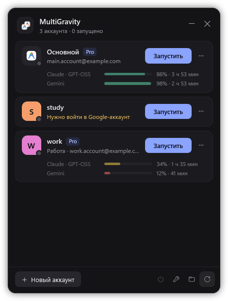
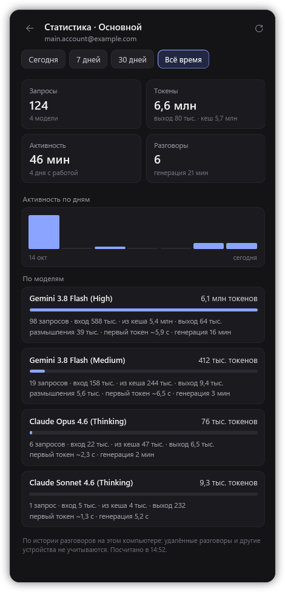

# 🪐 MultiGravity
<p align="center">
  
  
  
  <a href="./LICENSE"></a>
  <a href="https://github.com/Tixoni/MultiGravity/stargazers"></a>
  <a href="https://github.com/Tixoni/MultiGravity/issues"></a>
</p>

Лёгкий лаунчер для Windows, который запускает несколько аккаунтов Google Antigravity одновременно. Каждый аккаунт работает в своём изолированном профиле со своим входом, историей и настройками, а в одном окне видны почта, тариф, лимиты моделей и статистика использования каждого аккаунта.

<p align="center">
  
  
</p>

## 🌟 Возможности
- **Несколько аккаунтов одновременно** — основной Antigravity и любое число профилей, каждый в отдельном окне.
- **Управление в один клик** — запуск, переключение на окно уже запущенного аккаунта, закрытие и кнопка «Закрыть все сессии».
- **Почта и тариф** каждого аккаунта прямо в списке.
- **Лимиты моделей** — остаток по каждому общему пулу моделей и время до сброса. Пока аккаунт запущен, лимиты обновляются раз в минуту; у выключенного показываются последние известные значения.
- **Подробная статистика** — запросы и токены по каждой модели (вход, кеш, выход, размышления), время до первого токена, время активности, график по дням и периоды «Сегодня / 7 дней / 30 дней / Всё время».
- **Создание профилей** с чистыми настройками, с настройками основного аккаунта или копией другого профиля. Вход и токены при этом никогда не копируются.
- **Обслуживание** — подписи профилей, логи, папки данных, удаление и починка профилей.
- **Ничего лишнего** — только PowerShell и WPF, которые уже есть в Windows, и Python для консольной утилиты профилей.

## ⚙️ Требования
- **Windows** 10 или 11.
- **Antigravity** — десктопное приложение: [antigravity.google/download](https://antigravity.google/download).
- **Python 3** — [python.org/downloads](https://www.python.org/downloads/). При установке отметьте «Add python.exe to PATH».
- **VPN** — Antigravity и модели Google доступны не во всех регионах (в том числе недоступны в России). VPN должен быть включён и при входе в аккаунт, и во время работы.
- **[Open AG Patcher](https://github.com/trustybird/AvenCores-open-antigravity-patcher)** — патчер, который снимает региональную проверку аккаунта в Antigravity.

## 🚀 Установка
1. **Включите VPN.**
2. **Установите Antigravity** с [antigravity.google/download](https://antigravity.google/download), запустите его и войдите в свой основной Google-аккаунт.
3. **Пропатчите Antigravity** с помощью [Open AG Patcher](https://github.com/trustybird/AvenCores-open-antigravity-patcher): закройте Antigravity, запустите патчер от имени администратора и выберите пункт `2` *Antigravity 2.0 patch*.
   Все профили MultiGravity используют одну установку Antigravity, поэтому патч применяется один раз. **После обновления Antigravity патч нужно применить заново.**
4. **Установите Python 3**, если его ещё нет.
5. **Скачайте MultiGravity** и положите в постоянную папку (ярлык будет ссылаться на неё):
   ```bash
   git clone https://github.com/Tixoni/MultiGravity.git
   ```
   или **Code → Download ZIP** и распакуйте архив.
6. **Запустите `install.cmd`.** Он проверит Python и Antigravity, соберёт иконку MultiGravity из значка установленного Antigravity и создаст ярлык **MultiGravity** на рабочем столе и в меню «Пуск».

## 🧭 Как пользоваться
1. Откройте MultiGravity ярлыком.
2. Нажмите **«Новый аккаунт»**, введите имя профиля латиницей и подпись (например, почту), нажмите **«Создать»**. Откроется отдельное окно Antigravity — войдите в нём во второй Google-аккаунт.
3. Дальше запускайте любой аккаунт кнопкой **«Запустить»**. У запущенного аккаунта кнопка **«Открыть»** переключает на его окно.

| Элемент | Что делает |
|---|---|
| **Запустить / Открыть** | Запускает аккаунт или переключает на его окно. То же — двойной клик по карточке |
| **⋯ → Статистика** | Подробная статистика использования аккаунта |
| **⋯ → Закрыть** | Закрывает окна аккаунта, как крестиком: Antigravity успеет спросить про несохранённые файлы |
| **⋯ → Подпись…** | Подпись профиля в списке |
| **⋯ → Логи / Папка** | Открывает папку логов или данных аккаунта |
| **⋯ → Удалить…** | Удаляет профиль вместе со входом, историей и настройками |
| **Новый аккаунт** (`Ctrl+N`) | Создаёт новый профиль |
| Кнопка питания внизу | Закрыть все сессии |
| Гаечный ключ внизу | Проверить и починить профили (`pgrav doctor --fix`) |
| Папка внизу | Открыть папку профилей |
| Стрелка внизу | Обновить статусы и лимиты |

## 🖥️ Консольный режим (pgrav)
Профили создаются и запускаются консольной утилитой [ParaGravity](https://github.com/edison-land/paragravity) (`pgrav`), она уже лежит в `vendor/paragravity`. Ей можно пользоваться и без лаунчера — из корня репозитория:

```bat
vendor\paragravity\pgrav.cmd list
```

| Действие | Команда |
|---|---|
| Профили и их статус | `pgrav list` |
| Запустить профиль | `pgrav launch work` |
| Остановить профиль | `pgrav stop work --force` |
| Новый аккаунт | `pgrav create work --links minimal --launch` |
| С настройками основного аккаунта | `pgrav create work --links minimal -i` |
| Копия профиля | `pgrav create new --clone-from old --links minimal` |
| Удалить профиль | `pgrav delete work` |
| Починить профили | `pgrav doctor --fix` |
| Лог запуска | `pgrav logs work` |

Чтобы писать просто `pgrav`, добавьте папку `vendor\paragravity` в переменную `PATH`.

## 📊 Откуда берутся данные
- **Почта профиля** — из файла входа профиля: берётся только поле `email` из `id_token`, сами токены никуда не передаются.
- **Тариф, лимиты и почта основного аккаунта** — из локального API language server запущенного Antigravity (`GetUserStatus` на `127.0.0.1`). Это внутренний API: после обновления Antigravity он может измениться, тогда лимиты просто перестанут отображаться, а запуск аккаунтов продолжит работать.
- **Статистика** — `stats.py` открывает локальные базы разговоров (`.gemini\antigravity\conversations\*.db`) только на чтение и берёт метаданные генераций: модель, токены, длительность. Тексты разговоров не читаются. Удалённые разговоры и работа на других компьютерах не учитываются.
- **Кеш** последних лимитов и названий моделей — `%LOCALAPPDATA%\MultiGravity\cache.json`.

## ⚠️ Частые проблемы
- **Запрос висит на «Working» или модель не отвечает** — проверьте, что VPN включён и Antigravity пропатчен (после обновления — заново). Попробуйте другую модель: остаток лимитов виден в карточке аккаунта.
- **Не видно лимитов и тарифа** — их отдаёт только запущенный аккаунт. Запустите его и подождите около 10 секунд.
- **Вместо названия модели техническое имя** — названия подтягиваются, когда аккаунт запущен, и дальше запоминаются.
- **Лаунчер не открывается** — запустите `install.cmd` и проверьте, что Python найден. Чтобы увидеть ошибку, запустите из папки проекта:
  ```bat
  powershell -ExecutionPolicy Bypass -File launcher.ps1
  ```
- **Окна разных аккаунтов выглядят одинаково** — переключайтесь кнопкой «Открыть» в лаунчере: она поднимает окно нужного аккаунта.

## 🔒 Безопасность
- Токены входа профилей хранятся открытым текстом в `%USERPROFILE%\.antigravity-profiles`. Не синхронизируйте эту папку с облаком и не добавляйте её в Git.
- Профили создаются с `--links minimal`: в профиль не пробрасываются `~/.ssh`, `~/.config` и другие скрытые папки.
- Сам лаунчер ничего не отправляет в интернет: он обращается только к локальному language server на `127.0.0.1` и читает локальные файлы.

## 🗂️ Структура проекта
- `launcher.ps1` — окно лаунчера (PowerShell + WPF).
- `launcher.vbs` — запуск лаунчера без окна консоли.
- `stats.py` — подсчёт статистики по локальной истории разговоров.
- `install.cmd`, `install.ps1` — проверка зависимостей и создание ярлыков.
- `vendor/paragravity/` — консольная утилита ParaGravity (`pgrav`) для работы с профилями.
- `docs/` — скриншоты.

# 📜 Лицензия и атрибуция

Проект распространяется под лицензией MIT. Полный текст лицензии — в файле [`LICENSE`](LICENSE).

В `vendor/paragravity` включена утилита [ParaGravity](https://github.com/edison-land/paragravity) (© ParaGravity Contributors, лицензия MIT) без изменений; её лицензия — в [`vendor/paragravity/LICENSE`](vendor/paragravity/LICENSE).

[Open AG Patcher](https://github.com/trustybird/AvenCores-open-antigravity-patcher) — отдельный проект под лицензией GPL-3.0, в этот репозиторий он не входит.

Antigravity — продукт Google. MultiGravity — неофициальный проект и не связан с Google.
